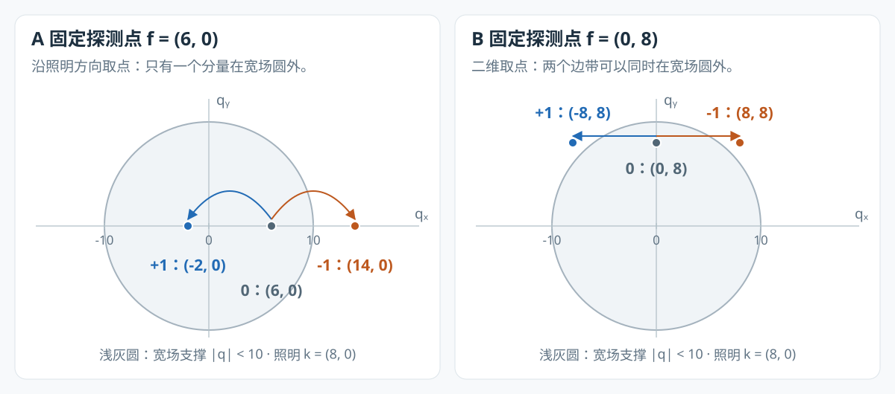
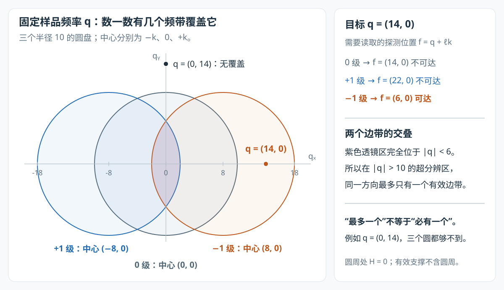

# 一个频谱点的 0、−1、+1 级，到底谁提供超分辨？

**你说的“只有一个具备超分辨能力”，在常见的单方向、沿照明波矢取点的例子里是对的。但要先分清：你固定的是搬移前的探测频率，还是搬移后的样品频率。**

- **固定探测频率 $\mathbf f$**：分离出的 0、±1 级对应三个不同的样品频率。哪些是新增高频，要分别检查它们搬回后是否超出宽场截止；二维情况下，可能有 0、1 或 2 个。
- **固定样品频率 $\mathbf q$**：在单方向、理想圆形 OTF 支撑的模型中，一个被覆盖的超分辨频率，确实只有一个边带能提供；多方向时可能有多个来源。

本篇先沿一个具体频率走完“照明混频 → 相机记录 → 相位分离 → 频谱归位”，再解释 fairSIM 为什么把搬移后的频带融合起来。

配套：[全流程图谱](sim_pipeline_atlas.html)的步骤 04–08 · [fairSIM 实现与数值对照](Wiener-SIM/fairSIM-论文/图谱实现对照.md)。

## 1. 先用一个点把问题说透

这里的“点”是**二维频谱中的一个复数系数**，不是图像里的一个空间像素，也不是一颗荧光分子。$S(\mathbf q)$ 的幅度与相位描述样品中相应空间频率的结构。

设检测截止半径 $k_c=10$，照明波矢 $\mathbf k=(8,0)$；单位是图谱里的 DFT 频率格。暂时只看水平方向，省略为零的第二个坐标。

对于探测频率 **$f=6$**，相机在第 $j$ 个照明相位记录的是

$$
D_j(6)=H(6)\left[S(6)+\frac m2 e^{i\phi_j}S(-2)
+\frac m2 e^{-i\phi_j}S(14)\right].
$$

也就是说，**同一个探测位置混着三个不同样品频率的信息**。它们并不是同一份 $S(6)$ 的三个副本。[S1、S2]

| 分离分量 | 在原始帧中的相位标签 | 搬回的样品频率 $q$ | 是否超出宽场截止 $\lvert q\rvert>10$？ |
|---|---|---|---|
| 0 级 | $1$ | $6$ | 否 |
| +1 级 | $e^{+i\phi_j}$ | $6-8=-2$ | 否 |
| −1 级 | $e^{-i\phi_j}$ | $6+8=14$ | **是** |

**在这个例子里，你的判断完全成立：只有 −1 级携带的 $S(14)$ 提供了超出宽场通带的信息。** 另外两个分量仍然有用，只是它们没有增加这个例子中的最高可达频率。

这里按“照明指数中的正负号”命名 ±1 级。因此本篇统一使用

$$
\boxed{\mathbf q=\mathbf f-\ell\mathbf k,\qquad \ell\in\{0,+1,-1\}.}
$$

+1 级归位到 $\mathbf f-\mathbf k$，−1 级归位到 $\mathbf f+\mathbf k$。交换照明波矢的正方向，就会交换两个边带的名字；“哪一个符号更有超分辨能力”不是物理不变量。这个约定与本地图谱的 `probe()` 一致。[S2、S3]

## 2. 超分辨发生在哪一步：先把高频录进去，再把地址还原

### 2.1 均匀照明为什么录不到 $S(14)$？

均匀照明时，成像关系是

$$
D_{\mathrm{WF}}(q)=H(q)S(q).
$$

因为 $14>k_c=10$，所以 $H(14)=0$。这个样品频率没有进入数据，之后单靠数值去卷积无法恢复它。

### 2.2 条纹照明把它变成了相机能记录的频率

采用负指数傅里叶变换，照明与成像模型为

$$
I_j(\mathbf r)=1+m\cos(2\pi\mathbf k\cdot\mathbf r+\phi_j),
\qquad d_j(\mathbf r)=[s(\mathbf r)I_j(\mathbf r)]*h(\mathbf r).
$$

照明平均强度已归一化；这里先忽略噪声与背景，$m>0$，相位和波矢已知。将余弦展开，再用“空间相乘对应频域卷积”，得到

$$
D_j(\mathbf f)=H(\mathbf f)
\left[S(\mathbf f)+\frac m2 e^{i\phi_j}S(\mathbf f-\mathbf k)
+\frac m2 e^{-i\phi_j}S(\mathbf f+\mathbf k)\right].
$$

这正是第 1 节公式的来源，也对应 fairSIM 分离矩阵中的三列。[S2]

沿着 $S(14)$ 这一项看：**样品频率 14 与照明频率 −8 混频，生成探测频率 $14-8=6$**。它经历的检测衰减是 $H(6)$，而非 $H(14)$。本地模型给出 $H(6)\approx0.2848>0$，因此它终于进入了相机数据。[S3]

$$
\underbrace{S(14)}_{\text{样品的高频}}
\xrightarrow{\text{条纹照明混频：}14-8=6}
\underbrace{\frac m2 e^{-i\phi_j}H(6)S(14)}_{\text{原始帧 }D_j(6)\text{ 中的一项}}.
$$

**SIM 获得新增信息的关键，是采集前的光学混频；软件搬移负责恢复这份信息的正确频率坐标。** 单纯把一张普通宽场图的频谱向外挪，不会得到相同的超分辨信息。

### 2.3 为什么要拍三相位，不能直接把 $D_j(6)$ 搬到 14？

因为 $D_j(6)$ 同时含 $S(6)、S(-2)、S(14)$。直接搬移会把三者一起错放。三相位利用不同的相位标签把它们分开。

令 $\phi_j=2\pi j/3$，$j=0,1,2$，并记

$$
a_0=1,\qquad a_{+1}=a_{-1}=m/2.
$$

由 $\sum_{j=0}^{2}e^{i(\ell-\ell')\phi_j}=3\delta_{\ell\ell'}$，可得

$$
\boxed{A_\ell(\mathbf f)=\frac{1}{3a_\ell}
\sum_{j=0}^{2}e^{-i\ell\phi_j}D_j(\mathbf f)
=H(\mathbf f)S(\mathbf f-\ell\mathbf k).}
$$

相位标签不同的项抵消，目标项保留。fairSIM 把 $m/2$ 放进矩阵并求逆，所以分离结果已经补偿了调制度；OTF 衰减仍在。[S2]

对 −1 级，我们得到 $A_{-1}(6)=H(6)S(14)$。再将整个分离频带按对应位移归位：

$$
C_\ell(\mathbf q)=A_\ell(\mathbf q+\ell\mathbf k)
=\underbrace{H(\mathbf q+\ell\mathbf k)}_{H_\ell(\mathbf q)}S(\mathbf q).
$$

于是 $C_{-1}(14)=A_{-1}(6)=H(6)S(14)$。**归位后，频谱和对应的 OTF 必须一起平移，不能又拿原点居中的 $H(14)=0$ 去判断这份信息。**

## 3. 为什么不能推广成“每个探测点都只有一个超分辨分量”？

### 3.1 同一个探测点，可能带回零个、一个或两个高频

判据始终是：搬回后的样品频率是否在宽场圆盘外。固定一个有效探测频率 $|\mathbf f|<k_c$ 后，逐项计算即可：

| 固定的探测频率 $\mathbf f$ | 0 级的 $\mathbf q$ | +1 级的 $\mathbf q$ | −1 级的 $\mathbf q$ | 超出截止半径 10 的分量数 |
|---|---|---|---|---|
| $(0,0)$ | $(0,0)$ | $(-8,0)$ | $(8,0)$ | **0** |
| $(6,0)$ | $(6,0)$ | $(-2,0)$ | $(14,0)$ | **1** |
| $(0,8)$ | $(0,8)$ | $(-8,8)$ | $(8,8)$ | **2** |

第三行中，两个边带都满足

$$
|\mathbf q_{\pm1}|=\sqrt{8^2+8^2}=\sqrt{128}\approx11.31>10.
$$

它们提供的是**两个不同的高频系数**，不是对同一个高频系数重复测量。



*图中画的是搬回后的样品频率坐标。浅灰圆为原点居中的宽场通带；箭头表示同一探测频率分离出的边带归位到哪里。所有坐标由 $\mathbf q=\mathbf f-\ell\mathbf k$ 计算。*

两边带同时在宽场外的条件也可直接推出：

$$
\min\bigl(|\mathbf f-\mathbf k|^2,|\mathbf f+\mathbf k|^2\bigr)
=|\mathbf f|^2+|\mathbf k|^2-2|\mathbf f\cdot\mathbf k|>k_c^2.
$$

在 $|\mathbf k|\le k_c$ 的通常情形下，沿 $\mathbf k$ 的一维截线上不会同时满足，但二维频谱里可以，例如上面的垂直取点。这是只看水平截线时容易漏掉的情况。

### 3.2 两个边带作为整体，都能扩展频谱

+1 级将通带中心移到 $-\mathbf k$，−1 级移到 $+\mathbf k$。它们分别扩展两侧的频率支撑；每个边带又都有一部分落在原宽场通带内。因此，**“边带”不等于“整个频带都是新增高频”，也不能据第 1 节的例子断言另一个边带在整张图上都没有高频价值。**

对实值样品，$S(-\mathbf q)=S(\mathbf q)^*$。第 1 节中 $S(14)$ 的共轭伙伴 $S(-14)$，由探测点 $f=-6$ 的 +1 级带回。两侧共同构成实值图像中的细条纹。理论上可利用共轭关系由半谱补齐另一半；fairSIM 仍显式处理两边，不能把它们理解成同一坐标上的两次独立采集。

0 级则覆盖整个原始低频圆盘，**不只是 $\mathbf q=0$ 这一个直流点**。它不扩展宽场截止，但为整体结构、强度和与边带重叠的频率提供数据。把它称为“没用”或“白给”会误导后续重建理解。

## 4. 搬移完成后：固定同一个样品频率，究竟有几路来源？

现在换一个问题：**已经指定最终频谱里的 $\mathbf q$，哪些分离分量能提供 $S(\mathbf q)$？**

从前面的式子反解，每一级需要读取的探测位置是

$$
\boxed{\mathbf f_\ell=\mathbf q+\ell\mathbf k.}
$$

这三个探测位置通常不同。只有 $H(\mathbf f_\ell)\ne0$ 的通路才有效。

以目标 **$q=14$** 为例：

| 想通过哪一级恢复 $S(14)$？ | 必须读取的探测频率 $f_\ell$ | 检测系统能否记录？ |
|---|---|---|
| 0 级 | $14$ | 否，$H(14)=0$ |
| +1 级 | $14+8=22$ | 否，$H(22)=0$ |
| −1 级 | $14-8=6$ | **能，$H(6)\approx0.2848$** |

**在这里，“只有一个边带提供这个超分辨频率”是正确的。** 它问的是同一个输出地址有几路来源，与第 3 节“同一个输入地址装着几个不同高频”不同。

### 4.1 为什么单方向下不可能有两个边带同时覆盖同一个超分辨频率？

在理想圆形检测支撑中，定义有效频带

$$
\Omega_\ell=\{\mathbf q:|\mathbf q+\ell\mathbf k|<k_c\}.
$$

三个圆盘中心分别为 $0、-\mathbf k、+\mathbf k$，半径均为 $k_c$。用严格小于号，是因为理想非相干 OTF 在截止边界上已经为零。

若两个边带都覆盖同一个 $\mathbf q$，则

$$
|\mathbf q-\mathbf k|^2<k_c^2,\qquad
|\mathbf q+\mathbf k|^2<k_c^2.
$$

相加并使用平行四边形恒等式：

$$
2|\mathbf q|^2+2|\mathbf k|^2<2k_c^2
\quad\Longrightarrow\quad
|\mathbf q|^2<k_c^2-|\mathbf k|^2.
$$

在本例中即 $|\mathbf q|<6$，完全位于宽场圆盘内部。故两个边带不可能在 $|\mathbf q|>10$ 处重叠；0 级在那里同样为零。



*两边带相互重叠的区域位于中央。$(14,0)$ 只有 −1 级覆盖；$(0,14)$ 则没有任何一级覆盖。圆周是支撑的极限边界，边界处的 OTF 为零。*

所以准确结论是：**单方向的一个超分辨频率，最多有一个边带覆盖；只有加上“位于该方向可恢复支撑内”，才能说恰好一个。** 例如 $(0,14)$ 虽然也是高频，却不在当前方向的任何圆盘里。

### 4.2 三方向时，同一高频可以有多路来源

照明波矢变为 $\mathbf k_1=(8,0)、\mathbf k_2=(4,7)、\mathbf k_3=(-4,7)$ 后，考虑 $\mathbf q=(10,6)$，其长度约为 $11.66>10$：

$$
\mathbf q-\mathbf k_1=(2,6),\quad |(2,6)|\approx6.32<10;
\qquad
\mathbf q-\mathbf k_2=(6,-1),\quad |(6,-1)|\approx6.08<10.
$$

前两个方向的 −1 级都能提供同一个 $S(10,6)$。本地模型对应的 OTF 分别约为 0.2522、0.2764。[S3]

多方向既扩展不同方位的覆盖，也可以增加高频区的多路观测。三方向支撑是多个移位圆盘的并集，通常仍有方向差异，不能直接说成“变成一个完整圆盘”；不同观测的噪声是否独立还取决于采集与分离过程。

## 5. fairSIM 真正融合的是什么？

**fairSIM 先把各频带放到共同的样品频率坐标，再在同一个 $\mathbf q$ 上累加。它不会把 $A_0(6)、A_{+1}(6)、A_{-1}(6)$ 当成对同一个样品频率的三次测量直接平均。**

以下核对的是本地 fairSIM 提交 `711afd12cb8c4fd4207bbca7ee7610c5aed4f732` 的二维 Wiener 路径，`otfBeforeShift=false`，关闭 OTF attenuation 和 RL。不是对所有 fairSIM 版本及配置的统一断言。[S2]

### 5.1 与源码逐步对上

| 过程 | fairSIM 操作 | 对应含义 |
|---|---|---|
| 相位分离 | `BandSeparation.separateBands` | 求逆得到 $A_\ell(\mathbf f)$；同时补偿 $m/2$ |
| 扩大计算网格 | `SimUtils.placeFreq` | 将频谱放入两倍边长的网格，给外移频带留出坐标；填零本身不产生信息 |
| 归位 | `SimUtils.fourierShift` | 正负分量分别搬移，得到 $C_\ell(\mathbf q)$ |
| OTF 匹配 | `OtfProvider.applyOtf` | 在归位坐标乘对应的共轭 $H_\ell^*(\mathbf q)$ |
| 累加 | `fullResult.add(shifted[i])` | 对各方向、各分量累加，形成同一输出网格上的分子 |
| 正则化与切趾 | `getDenominator(w)`、`writeApoVector` | 乘正则化分母的倒数，再乘切趾窗，最后逆 FFT |

fairSIM 中还要区分**频带参数 `b`** 和**分离分量编号**：二维三相位情形 `nrBand=2`，表示零级与一级谐波；分离分量有三个，按本篇约定为 `separate[0] → 0`、`separate[1] → +1`、`separate[2] → −1`。代码里的 `pos=2`、`neg=1` 描述搬移方向，不能直接当作照明相位指数的正负号。[S2]

### 5.2 先理解标准的融合式，再看源码的计数

归位后，每一路均有

$$
C_{d,\ell}(\mathbf q)=H_{d,\ell}(\mathbf q)S(\mathbf q)+n_{d,\ell}(\mathbf q).
$$

如果采用等权二次误差与二次正则化，在每个 $\mathbf q$ 上求

$$
\min_z\left[\sum_{d,\ell}|C_{d,\ell}-H_{d,\ell}z|^2+w^2|z|^2\right],
$$

对 $z^*$ 求导并令其为零，得到标准形式

$$
\widehat S_{\mathrm{standard}}=
\frac{\sum_{d,\ell}H_{d,\ell}^*C_{d,\ell}}
{\sum_{d,\ell}|H_{d,\ell}|^2+w^2}.
$$

这解释了“乘共轭 OTF、累加、除以 OTF 平方和加正则项”的逻辑。无噪声且参数匹配时，分子的每一项都是 $|H_{d,\ell}|^2S(\mathbf q)$，不会把同一结构无条件叠亮。

**但当前 fairSIM 代码的实际分母有一个必须保留的细节：零级计数两次。** `WienerFilter.addWienerDenominator` 每个 `b` 都累加正、负两个位置的 OTF 平方；`b=0` 时两个位置相同，分子却只累加一次零级。因此当前图谱严格对应

$$
U(\mathbf q)=\sum_d\sum_{\ell=0,\pm1}H_{d,\ell}^*(\mathbf q)C_{d,\ell}(\mathbf q),
$$

$$
D_{\mathrm{code}}(\mathbf q)=\sum_d\left[
2|H_{d,0}(\mathbf q)|^2+|H_{d,+1}(\mathbf q)|^2+|H_{d,-1}(\mathbf q)|^2\right],
$$

$$
\boxed{\widehat S_{\mathrm{out}}(\mathbf q)
=W_{\mathrm{apo}}(\mathbf q)\frac{U(\mathbf q)}{D_{\mathrm{code}}(\mathbf q)+w^2}.}
$$

这里 $W_{\mathrm{apo}}$ 是切趾窗。原文直接把标准分母当作本版本的实际分母，并不准确。此差别影响宽场内的幅度；在超分辨区，$H_{d,0}=0$，零级重复计数不影响那里。[S2、S3]

此外，分离时除以 $m$ 会改变边带噪声，等相位或不同相位也影响噪声协方差。该源码路径没有再显式使用逐频带噪声方差权重，不能仅凭它叫 Wiener 就称为“严格的最小均方误差最优融合”。

### 5.3 回到 $q=14$：三个分量都加，为什么仍只有一个起作用？

单方向时，$H_0(14)=H(14)=0$，$H_{+1}(14)=H(22)=0$，只有 $H_{-1}(14)=H(6)\ne0$。所以切趾前自动简化为

$$
\widehat S_{\mathrm{pre}}(14)=
\frac{H^*(6)C_{-1}(14)}{|H(6)|^2+w^2}.
$$

无效通路在**乘共轭 OTF 的分子和 OTF 平方分母中都为零**。因此 fairSIM 可以用同一个逐点公式处理：低频重叠区的多路融合、单方向高频区的一路恢复，以及无覆盖区的零输出。

**同理，在三方向的 $(10,6)$，公式保留两条有效通路，融合的是它们对同一个 $S(10,6)$ 的观测。** 这才是“频带重叠”和“同一点融合”的准确含义。

## 6. 有高频通路，还不等于实际图像一定分辨得出来

频带几何只回答“数据能从哪条路来”。结构是否实际存在、调制度、光子数、相位和波矢误差，以及正则化和切趾，都影响最后能否可靠辨认。

在仅有一路的频率上，写 $C=HS+n$，切趾前有

$$
\widehat S=\underbrace{\frac{|H|^2}{|H|^2+w^2}}_{\text{信号传递}}S
+\underbrace{\frac{H^*}{|H|^2+w^2}}_{\text{噪声振幅增益}}n.
$$

取 $q=17$、$k=8$，对应 $f=9$。本地 OTF 为 $H(9)\approx0.03739$：

| 条件 | 信号传递（切趾前） | 分离后噪声的振幅增益 |
|---|---|---|
| $w=0$ | $1$ | $1/|H|\approx26.75$ |
| $w=0.05$ | 约 $0.359$ | 约 $9.59$ |

$w=0$ 时的 $1/|H|^2\approx715$ 是**噪声方差增益**，不是振幅增益。这里的噪声指分离后的 $n$，已经包含相位解混和调制度补偿的影响；输出再乘切趾窗后，信号与噪声还会同时衰减。

沿照明方向，几何可达频率的上界为 $k_c+|\mathbf k|=18$，相对于宽场的支撑扩展上限为 $1.8$ 倍；**边界本身 OTF 为零，不能由这个比值直接断言实测分辨率提高了 1.8 倍**。也没有不依赖样品与噪声的“11–15 格才算可用”统一阈值。

## 7. 用本地 fairSIM 图谱代码复核这些点

在项目根目录执行下面的代码。它调用本地图谱的 `capture()`、`pipeline()` 和 `probe()`，不依赖浏览器中残留的参数；参数固定为单方向、无噪声、调制度 0.8。

```sh
node <<'JS'
const A = require('./web/atlas/sim-atlas-core.js');
const cap = A.capture({sample:'star-points', directions:1, m:0.8, noise:'none'});
const p = A.pipeline(cap.raw, cap.calibration, {}, cap.truth.m);
for (const f of [[0,0], [6,0], [0,8]]) {
  const probe = A.probe(p, 0, ...f);
  console.log('固定 f =', f, probe.orders.map(o => ({
    order: o.order, q: o.specimenFrequency,
    beyondWidefield: Math.hypot(...o.specimenFrequency) > p.cutoff
  })));
}
for (const q of [[0,0], [6,0], [14,0], [0,14]]) {
  const i = A.idx(...q, p.spectrumSize);
  console.log('固定 q =', q, p.bands.filter(b => b.h[i] > 0).map(b => ({
    order: b.order, f: [q[0]+b.kx, q[1]+b.ky], H: b.h[i]
  })), {Q: p.signalResponse[i], Dcode: p.denominator[i]});
}
JS
```

第一组输出的超分辨分量数依次为 **0、1、2**；第二组目标频率的有效来源数依次为 **3、2、1、0**。在 $\mathbf q=0$ 处，$Q\approx1.021669$、$D_{\mathrm{code}}\approx2.021669$，其差为额外计数的一份 $|H_0(0)|^2=1$。

这些是当前理想模拟配置的数值核对，不是显微镜实验测量。图谱与原始 Java 输出的逐像素对照方法见 [实现对照](Wiener-SIM/fairSIM-论文/图谱实现对照.md)。两张几何图可用 `python3 scripts/render_sim_band_figures.py` 重新生成，只依赖 Python 标准库。

## 来源与适用范围

- **[S1] 背景论文**：Müller et al., “Open-source image reconstruction of super-resolution structured illumination microscopy data in ImageJ”, *Nature Communications* 7, 10980 (2016)，[DOI](https://doi.org/10.1038/ncomms10980)。本篇的具体符号从第 2 节成像模型显式推导，数值实现以以下固定源码为准。
- **[S2] 已核对的 fairSIM 源码**：本地 `Wiener-SIM/fairSIM-src/fairSIM/`，提交 `711afd12cb8c4fd4207bbca7ee7610c5aed4f732`，pom 版本 1.5.1；这是后续维护版本，不是 2016 年论文的代码快照。
- **[S3] 本项目实现**：[图谱核心](web/atlas/sim-atlas-core.js)、[配置与 Java 对照说明](Wiener-SIM/fairSIM-论文/图谱实现对照.md)。文中 OTF 数字使用其 512 点采样与线性插值实现；几何坐标、重叠证明由本文公式直接计算。

| 核对项 | 固定提交中的源码位置 |
|---|---|
| $m/2$、正负相位列、矩阵求逆 | [BandSeparation.java，80–118 行](https://github.com/fairSIM/fairSIM/blob/711afd12cb8c4fd4207bbca7ee7610c5aed4f732/src/main/java/org/fairsim/sim_algorithm/BandSeparation.java#L80-L118) |
| 分离、填充、正负搬移 | [SimAlgorithm.java，601–628 行](https://github.com/fairSIM/fairSIM/blob/711afd12cb8c4fd4207bbca7ee7610c5aed4f732/src/main/java/org/fairsim/sim_algorithm/SimAlgorithm.java#L601-L628) |
| 乘移位 OTF、逐分量累加 | [SimAlgorithm.java，633–659 行](https://github.com/fairSIM/fairSIM/blob/711afd12cb8c4fd4207bbca7ee7610c5aed4f732/src/main/java/org/fairsim/sim_algorithm/SimAlgorithm.java#L633-L659) |
| `val.conj()`：确实乘共轭 OTF | [OtfProvider.java，505–519 行](https://github.com/fairSIM/fairSIM/blob/711afd12cb8c4fd4207bbca7ee7610c5aed4f732/src/main/java/org/fairsim/sim_algorithm/OtfProvider.java#L505-L519) |
| OTF 平方的正负两项；零级也走此循环 | [WienerFilter.java，66–81 行](https://github.com/fairSIM/fairSIM/blob/711afd12cb8c4fd4207bbca7ee7610c5aed4f732/src/main/java/org/fairsim/sim_algorithm/WienerFilter.java#L66-L81) |
| 所有方向与 `b=0` 起的频带计数、加 $w^2$ 取倒数 | [WienerFilter.java，104–126 行](https://github.com/fairSIM/fairSIM/blob/711afd12cb8c4fd4207bbca7ee7610c5aed4f732/src/main/java/org/fairsim/sim_algorithm/WienerFilter.java#L104-L126) |
| 最终滤波、切趾、逆变换 | [SimAlgorithm.java，745–771 行](https://github.com/fairSIM/fairSIM/blob/711afd12cb8c4fd4207bbca7ee7610c5aed4f732/src/main/java/org/fairsim/sim_algorithm/SimAlgorithm.java#L745-L771) |

本篇限定于**二维线性、正弦照明的 0、±1 级模型**；关于同方向重叠的证明还使用理想圆形支撑。3D-SIM、非线性 SIM 或不同形状的 OTF 支撑，需按其实际频带和几何重新分析。
