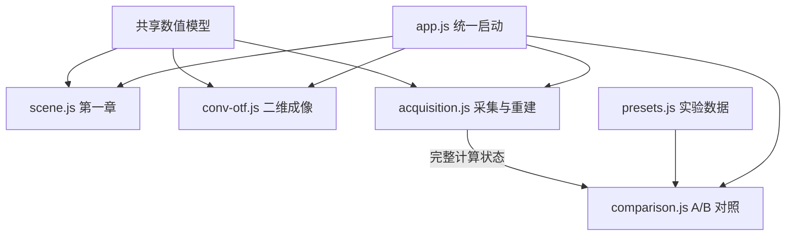

# SIM 交互实验室代码结构

页面入口是根目录的 [sim_interactive_demo.html](../sim_interactive_demo.html)。实验室独占代码与样式集中在本目录；共享数值模型继续由根目录 `sim-core.js`、`sim-experiment.js` 提供。

## 修改位置

| 文件 | 职责 | 常见修改 |
|---|---|---|
| [app.js](app.js) | 唯一启动入口，组装各模块，管理章节、重置与页内导航 | 初始化顺序、章节切换 |
| [scene.js](scene.js) | 第一章的解析成像、光路图、截线和相移动画 | 光路显示、CH1–CH4、动画 |
| [conv-otf.js](conv-otf.js) | 第一章二维 PSF/OTF 实验 | 二维样品、卷积与频谱显示 |
| [acquisition.js](acquisition.js) | 第二章参数、采集缓存、重建、频率覆盖和原始帧弹窗 | 方向开关、噪声、重建控制 |
| [presets.js](presets.js) | A/B 实验数据、分组与说明文字 | 新增或修改对照实验 |
| [comparison.js](comparison.js) | 固定 A、实时 B、差值图、指标与空状态 | 对照展示、指标排版 |
| [ui.js](ui.js) | 公式与数值格式、DOM 查询、灰度绘图 | 通用显示工具 |
| [base.css](base.css) | 页面基础样式与第一章 | 字体、导航、成像实验排版 |
| [acquisition.css](acquisition.css) | 第二章与 A/B 样式 | 方向开关、采集控制台、指标 |

## 初始化与数据流

各文件只注册模块，由最后加载的 `app.js` 统一启动。保留普通 script 标签，因此直接双击 HTML 和通过本地 HTTP 预览都可使用，不需要打包，也不依赖远程资源。



采集模块维护自己的缓存与结果，并通过 `subscribe()` 通知对照模块。对照模块由启动入口显式传入采集实例，不再监听文档级的 `sim-updated` 事件，也不依赖另一个脚本提前修改全局结果。

所有实验室接口收在 `window.SIMLab` 下。调试时可查看 `SIMLab.app.acquisition.latest` 与 `SIMLab.app.comparisons.reference`。各模块的 `init()` 可以重复调用，不会重复注册操作或累加下拉选项。

方向是否采集直接读取原生 checkbox/switch 的选中状态，显示文字与角度滑块禁用状态由此派生。三相位帧固定保留，用标题说明，不再使用不可点击的按钮；相移量仍可调整。

## 本次黑屏的原因与约束

旧来源文件保存了渲染后的 A/B 文本，但保存 HTML 不会保存 Canvas 的位图。对照模块缺少首次渲染，又错过了采集模块提前发出的更新事件，造成“旧数值仍在、画布为空”。

现在启动时明确渲染对照状态：没有 A 时显示建立对照的提示，并清除旧分数与像素；载入实验后才显示由真实数组绘制的三张图。回归检查会模拟旧页面保存的 RMSE，再逐像素验证载入后的 A、B 与差值图。

后续修改遵循这些边界：

- 共享计算层不读取 DOM，不反向依赖实验室页面。
- 实验预设只保存数据，不绑定事件、不主动运行实验。
- 新事件与订阅在模块 `init()` 中注册，跨模块操作由 `app.js` 组装。
- 渲染后的公式、数值和 Canvas 都是派生结果，不把保存的页面状态当成计算数据。
- 同一控件的样式放在所属 CSS 中维护，不在文件末尾追加多套同名覆盖规则。
- 新增 JS/CSS 时同步更新 `tests/sim-page-boundary.test.cjs` 的归属清单。

## 检查与预览

在项目根目录运行：

```sh
npm run check    # 数值、资源链接与模块边界
npm run test:ui  # 桌面 Chromium、交互及黑屏回归
npm run preview  # 仅本机可访问的 HTTP 预览，默认端口 8765
```

页面本身不需要安装 npm 依赖。检查命令使用本机现有的 Node、Python 和 Playwright；在其他电脑运行浏览器检查时，可通过 `SIM_PLAYWRIGHT_DIR` 与 `SIM_BROWSER_EXECUTABLE` 指定已安装的工具路径。

本轮整理前的原文件快照位于 `tmp/sim-structure-before/`，保留原目录结构。WorkBuddy 来源副本未修改；日常修改与预览使用本地项目根目录的 HTML。
