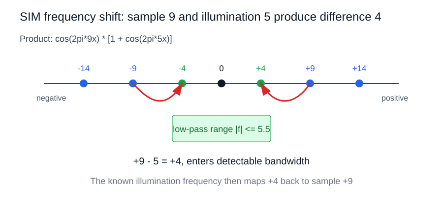

# SIM 基础与频谱直觉

[知识库目录](../SIM知识库.md) · [项目总览](../SIM项目总览.md) · [文献目录](../SIM文献目录.md)

> 阅读目标：先理解空间频率、OTF、摩尔纹和负频率，再阅读严格的前向模型。
> 依据：S1（SIM 综述）；H（由傅里叶变换与三角恒等式展开的解释）。详见[来源编号与证据约定](08-术语与参考来源.md)。
> 整理：2026-09-26；文中实验数字保留原有文献条件，工程建议不视为已验证结论。

## 本页目录

- [1. 一句话理解 SIM](#s1)
  - [1.1. 与超分辨目标的关系](#s1-1)
- [2. 图像不是二值亮暗，而是连续强度场](#s2)
- [3. 普通显微镜是受 OTF 限制的低通系统](#s3)
- [4. 摩尔条纹与“频率搬移”](#s4)
  - [4.1. 包络是什么：快载波外面的慢变化](#s4-1)
- [5. 为什么会出现 $S(\mathbf k\pm\mathbf k_i)$](#s5)
- [6. 负频率 $S(-k)$ 的意义](#s6)
- [7. 相机看到的是空域，频域由 FFT 得到](#s7)

<a id="s1"></a>

## 1. 一句话理解 SIM

普通荧光显微镜可近似看作一个低通系统，只能通过样品空间频率中位于 OTF 支撑域内的部分。SIM 用已知的周期性照明把样品的高频信息搬移到 OTF 内，再通过多幅不同相位/方向的观测把这些频带分离并搬回原位置。

因此，SIM 的核心不是“后处理锐化”，而是：

$$
\mathrm{illumination\ encoding}
\;\rightarrow\;
\mathrm{frequency\ shifting}
\;\rightarrow\;
\mathrm{model\ inversion}.
$$

深度学习可以帮助估计参数、抑制噪声、加速反演或建模残差，但如果网络产生的细节不受观测模型约束，就可能是统计幻觉而不是被测样品结构。

<a id="s1-1"></a>

### 1.1. 与超分辨目标的关系

横向分辨率的经典尺度可写成

$$
 d_{xy}\approx \frac{\lambda}{2\,\mathrm{NA}},
$$

轴向分辨率通常更差，数量级可写为

$$d_z\approx \frac{n\lambda}{\mathrm{NA}^2}$$

具体常数随相干性、检测方式和定义而变。SIM 通过频谱搬移把有效截止频率推向更高频率。理想线性 2D-SIM 的扩展上限约为传统宽场的 2 倍；真实结果还受 OTF、照明调制度、噪声、像差、采样和重建正则化影响。

<a id="s2"></a>

## 2. 图像不是二值亮暗，而是连续强度场

显微镜相机记录的不是“亮/暗标签”，而是每个像素上的光子数或电子数。可将样品表示为非负的连续强度函数：

$$
s(x,y)\in\mathbb R_{\ge 0}.
$$

一次 raw 采集得到的也是灰度强度矩阵。理想化的一维例子可以写为

$$
s(x)=A+B\cos(2\pi f_xx),
$$

其中 $f_x$ 是空间频率，单位为 cycles/$\mu\mathrm m$。若结构周期为 $T$，则

$$
f_x=\frac1T.
$$

因此宽条纹（周期长）是低频，细密条纹（周期短）是高频；均匀背景对应 $f_x=0$ 的直流分量。真实样品通常由许多频率共同组成：

$$
s(x)=\sum_k S(k)e^{i2\pi kx}.
$$

低频决定大尺度轮廓，高频决定边缘、细丝和小颗粒等细节。显微镜滤掉高频后，物体通常表现为边缘变钝、相邻结构粘连，而不是简单地变成黑色。

<a id="s3"></a>

## 3. 普通显微镜是受 OTF 限制的低通系统

普通荧光显微镜的空间域模型为

$$
y(\mathbf r)=s(\mathbf r)*h(\mathbf r)+n(\mathbf r).
$$

傅里叶变换后：

$$
Y(\mathbf k)=S(\mathbf k)H(\mathbf k)+N(\mathbf k).
$$

当某个频率超出 OTF 支撑域时，$H(\mathbf k)\approx0$，该频率的样品信息就无法被可靠传递。横向分辨率的数量级可写成

$$
d_{xy}\approx\frac{\lambda}{2\,\mathrm{NA}}.
$$

这里的 OTF 像一个“频率闸门”：低频可以通过，高频逐渐衰减，超过截止频率后几乎不再传递。需要注意，光学截止频率和相机采样的奈奎斯特频率是两道不同的限制：

$$
f_N=\frac{f_{\mathrm{sampling}}}{2}.
$$

超出 $f_N$ 的频率可能发生采样混叠，折叠成错误的低频，因此实验中还必须满足足够的像素采样。

<a id="s4"></a>

## 4. 摩尔条纹与“频率搬移”

两组相近频率的条纹叠加，会产生一个低频包络。由积化和差公式：

$$
\cos(2\pi f_1x)+\cos(2\pi f_2x)
=2\cos\left(2\pi\frac{f_1-f_2}{2}x\right)
\cos\left(2\pi\frac{f_1+f_2}{2}x\right).
$$

快速项的频率约为 $(f_1+f_2)/2$，慢速包络的频率约为 $|f_1-f_2|/2$。肉眼看见的宽条纹主要来自这个低频包络。

SIM 有意利用相同的“混频”机制，但使用的是乘法。设样品中有一个高频分量

$$
s(x)=\cos(2\pi f_sx),
$$

结构光为

$$
I(x)=1+m\cos(2\pi f_ix+\phi),
$$

则

$$
\begin{aligned}
s(x)I(x)
={}&\cos(2\pi f_sx)\\
&+\frac m2\cos\big(2\pi(f_s-f_i)x-\phi\big)\\
&+\frac m2\cos\big(2\pi(f_s+f_i)x+\phi\big).
\end{aligned}
$$

因此样品频率 $f_s$ 产生三个频率：

$$
f_s,\qquad f_s-f_i,\qquad f_s+f_i.
$$

对应的频率轴示意如下：



例如 $f_s=9$、$f_i=5$，会产生 (9,4,14)。如果显微镜只能通过 $|f|\le5.5$，则差频 $4$ 落入可探测范围；$9$ 和 $14$ 仍在光学带宽之外。SIM 根据已知的 $f_i$ 把测到的差频再搬回 $9$ 的位置。

<a id="s4-1"></a>

### 4.1. 包络是什么：快载波外面的慢变化

包络不是另一条独立的细条纹，而是描述“快速振荡的振幅在空间上如何缓慢变化”的函数。设两组接近频率的余弦为

$$
x_1(x)=\cos(2\pi f_1x),\qquad x_2(x)=\cos(2\pi f_2x).
$$

由积化和差公式：

$$
x_1(x)+x_2(x)
=2\cos\left(2\pi\frac{f_1-f_2}{2}x\right)
\cos\left(2\pi\frac{f_1+f_2}{2}x\right).
$$

定义

$$
f_{env}=\frac{|f_1-f_2|}{2},\qquad
f_{car}=\frac{f_1+f_2}{2},
$$

则第一个因子是慢变化的包络，第二个因子是快速载波。包络的幅度为

$$
A_{env}(x)=2\left|\cos(2\pi f_{env}x)\right|.
$$

例如 $f_1=18$、$f_2=22$ 时，载波频率为 $20$，包络的有符号频率为 $2$。两组条纹自身都很细，但它们的相对位置会缓慢地“对齐—错开—再对齐”：

```text
两条纹对齐       -> 亮度增强
亮线遇到暗线     -> 亮度减弱
再次对齐         -> 亮度增强
```

因此肉眼看到的宽明暗带就是包络。包络的周期由频率差决定：频率越接近，包络变化越慢、明暗带越宽；频率差越大，包络变化越快、明暗带越窄。

包络会改变局部对比度，并可能产生可见的摩尔条纹或拍频。当采样系统只能看到包络而看不见载波时，包络可能伪装成低频结构。SIM 把这种混频设计成可逆过程：样品频率 $f_s$ 与照明频率 $f_i$ 相乘后产生

$$
f_s-f_i,\qquad f_s+f_i.
$$

差频 $f_s-f_i$ 可能进入 OTF 带宽，和频 $f_s+f_i$ 通常落在带宽外。只要照明频率、相位和 OTF 已知，就能利用多相位观测把差频分量识别出来，再搬回样品原来的高频位置。若相位或波矢估计错误，包络的相位和位置会错，重建后常表现为条纹、重影、方向性伪影或频谱接缝。

<a id="s5"></a>

## 5. 为什么会出现 $S(\mathbf k\pm\mathbf k_i)$

正弦结构光在复指数形式下包含三个照明频率：

$$
0,\qquad+\mathbf k_i,\qquad-\mathbf k_i.
$$

其中

$$
\cos(2\pi\mathbf k_i\cdot\mathbf r+\phi)
=\frac12e^{i\phi}e^{i2\pi\mathbf k_i\cdot\mathbf r}
+\frac12e^{-i\phi}e^{-i2\pi\mathbf k_i\cdot\mathbf r}.
$$

样品频率 $\mathbf k$ 与 $+\mathbf k_i$ 相乘后变为 $\mathbf k+\mathbf k_i$，与 $-\mathbf k_i$ 相乘后变为 $\mathbf k-\mathbf k_i$。所以在相机检测位置 $\mathbf k$ 处，混合结果包含：

$$
D_\phi(\mathbf k)=I_0H(\mathbf k)\left[S(\mathbf k)+\frac m2e^{i\phi}S(\mathbf k-\mathbf k_i)+\frac m2e^{-i\phi}S(\mathbf k+\mathbf k_i)\right]+N(\mathbf k).
$$

三个未知量是

$$
X_0=S(\mathbf k)H(\mathbf k),\quad
X_{-1}=S(\mathbf k-\mathbf k_i)H(\mathbf k),\quad
X_{+1}=S(\mathbf k+\mathbf k_i)H(\mathbf k).
$$

它们是同一个检测频率位置上混合的三个样品频谱分量，并不是三个像素。

<a id="s6"></a>

## 6. 负频率 $S(-k)$ 的意义

负频率是傅里叶表示中的数学分量，不代表一种负的物理频率。实值图像满足共轭对称：

$$
S(-k)=S^*(k),\qquad |S(-k)|=|S(k)|.
$$

正负频率共同保证逆傅里叶变换得到实值图像。它在 SIM 中仍然必须解混，因为它会真实地参与相机信号。例如相机检测 $k=2$、结构光 $k_i=5$ 时：

$$
(-3)+5=2,\qquad 7-5=2.
$$

所以 $S(-3)$ 与 $S(7)$ 都会混入检测位置 $2$：

$$
D_\phi(2)=I_0H(2)\left[S(2)+\frac m2e^{i\phi}S(-3)+\frac m2e^{-i\phi}S(7)\right].
$$

若不解混，就无法判断某个亮度变化究竟来自低频 $S(2)$、负频率副本 $S(-3)$，还是真正的超分辨高频 $S(7)$，最终可能产生条纹、重影、振铃和频谱接缝伪影。

<a id="s7"></a>

## 7. 相机看到的是空域，频域由 FFT 得到

相机直接记录的是空域灰度图 $d_j(x,y)$。频域图像不是相机直接拍到的，而是对 raw 图像做二维离散傅里叶变换：

$$
D_j(k_x,k_y)=\mathcal F\{d_j(x,y)\}.
$$

实际显示时通常画频谱幅度的对数：

$$
\log\big(1+|D_j(k_x,k_y)|\big).
$$

频域中心是低频，离中心越远代表越细的空间结构。竖直条纹在频域中会在水平方向出现 $+f$ 和 (-f) 两个亮点；条纹越密，亮点离中心越远。SIM 软件的 FFT、频谱分离、频谱搬移和逆 FFT，正是把相机记录的空域强度转换为可操作的频谱地图，再将各频带拼回去。

可将流程画成：

```text
相机 raw 空域图像 d_j(x,y)
          |
          | FFT
          v
频域混合图 D_j(kx,ky)
          |
          | 多相位解混：分离 0、+1、-1 级
          v
把副本搬回真实样品频率位置
          |
          | OTF/Wiener 加权融合
          v
逆 FFT -> 重建空域图像 x_hat(x,y)
```

---

[返回知识库目录](../SIM知识库.md) · 下一专题：[统一成像模型与 SIM 分类](02-统一成像模型与SIM分类.md)
